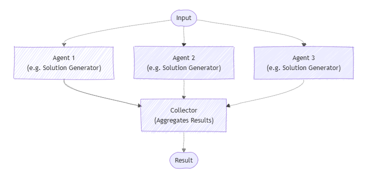
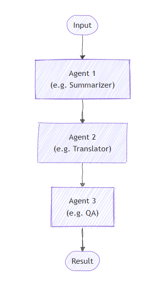
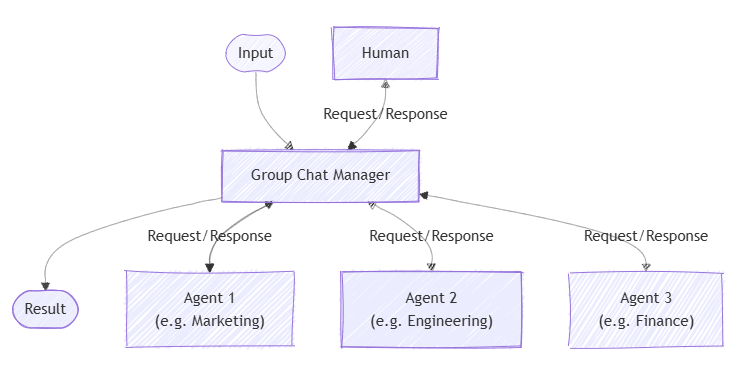
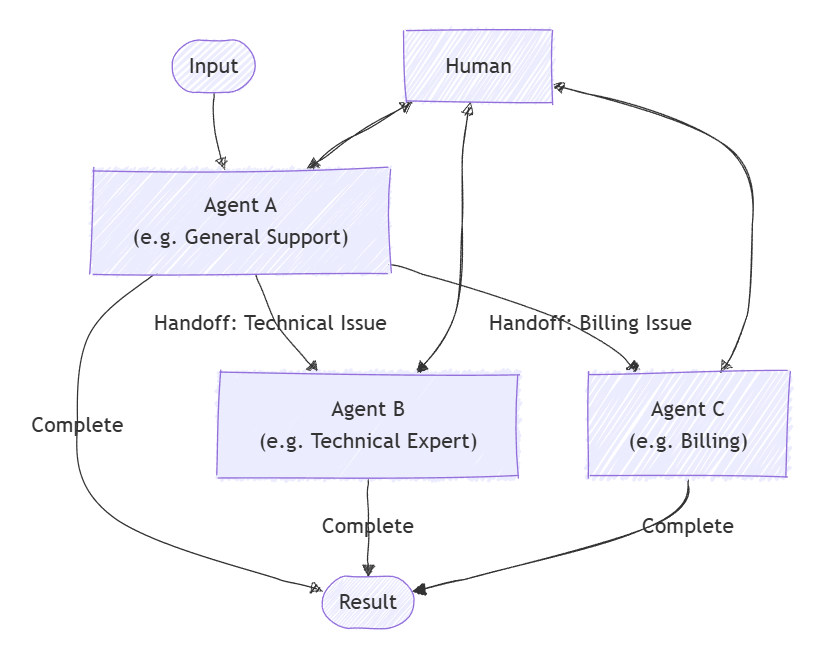

# Concurrent orchestration

Concurrent orchestration lets multiple agents work on the same task at the same time. Each agent handles the task independently, and then their outputs are gathered and combined. This method works especially well when you want diverse approaches or solutions, like during brainstorming, group decision-making, or voting.



When to use concurrent orchestration
You may want to consider using the concurrent orchestration pattern in these situations:

When tasks can run at the same time, either by using a fixed group of agents or by selecting AI agents dynamically based on what the task needs.
When the task benefits from different specialized skills or approaches (for example, technical, business, or creative) that all work independently but contribute to solving the same problem.
This kind of teamwork is common in multi-agent decision-making methods such as:

Brainstorming ideas
Combining different reasoning methods (ensemble reasoning)
Making decisions based on voting or consensus (quorum)
Handling tasks where speed matters and running agents in parallel cuts down wait time
When to avoid concurrent orchestration
You may want to avoid using the concurrent orchestration pattern in the following scenarios:

Agents need to build on each other's work or depend on shared context in a specific order.
The task requires a strict sequence of steps or predictable, repeatable results.
Resource limits, like model usage quotas, make running agents in parallel inefficient or impossible.
Agents can't reliably coordinate changes to shared data or external systems while running at the same time.
There's no clear way to resolve conflicts or contradictions between results from different agents.
Combining results is too complicated or ends up lowering the overall quality.

### Code
```python
research_agent = chat_client.create_agent(name="Researcher-Agent", ...)
plan_agent = chat_client.create_agent(name="Plan-Agent", ...)

workflow = ConcurrentBuilder().participants([research_agent, plan_agent]).build()

events = await workflow.run("Plan a trip to Seattle in December")
```

# Sequential orchestration
Sequential orchestration, agents are arranged in a pipeline where each agent processes the task one after another. The output from one agent becomes the input for the next. This pattern is ideal for workflows where each step depends on the previous one, such as document review, data transformation pipelines, or multi-stage reasoning.



Sequential orchestration works best for tasks that need to be done step-by-step, with each step improving on the last. The order in which agents run is fixed and decided beforehand, and agents don't decide what happens next.

When to use sequential orchestration
Consider using the sequential orchestration pattern when your workflow has:

Processes made up of multiple steps that must happen in a specific order, where each step relies on the one before it.
Data workflows where each stage adds something important that the next stage needs to work properly.
Tasks where stages can't be done at the same time and must run one after another.
Situations that require gradual improvements, like drafting, reviewing, and polishing content.
Systems where you know how each agent performs and can handle delays or failures in any step without stopping the whole process.
When to avoid sequential orchestration
Avoid this pattern when:

Stages can be run independently and in parallel without affecting quality.
A single agent can perform the entire task effectively.
Early stages may fail or produce poor output, and there's no way to stop or correct downstream processing based on errors.
Agents need to collaborate dynamically rather than hand off work sequentially.
The workflow requires iteration, backtracking, or dynamic routing based on intermediate results.

### Code
```python
research_agent = chat_client.create_agent(name="Researcher-Agent", ...)
plan_agent = chat_client.create_agent(name="Plan-Agent", ...)

workflow = SequentialBuilder().participants([research_agent, plan_agent]).build()

events = await workflow.run("Plan a trip to Seattle in December")
```

# Group chat orchestration

Group chat orchestration models a collaborative conversation among multiple AI agents, and optionally a human participant. A central chat manager controls the flow, deciding which agent responds next and when to request human input. This pattern is useful for simulating meetings, debates, or collaborative problem-solving.



The group chat pattern works well for scenarios where group discussion or iterative collaboration is key to reaching decisions. It supports different interaction styles, from free-flowing ideation to formal workflows with defined roles and approval steps. Group chat orchestration is also great for human-in-the-loop setups where a human may guide or intervene in the conversation. Typically, agents in this pattern don't directly change running systems—they mainly contribute to the conversation.

### Consider using group chat orchestration when your scenario involves:
- Spontaneous or guided collaboration among agents (and possibly humans)
- Iterative maker-checker loops where agents take turns creating and reviewing
- Real-time human oversight or participation
- Transparent and auditable conversations since all output is collected in a single thread

### Common scenarios include:
- Creative brainstorming where agents build on each other's ideas
- Decision-making that benefits from debate and consensus
- Complex problems requiring cross-disciplinary dialogue
- Quality control and validation requiring multiple expert perspectives
- Content workflows with clear separation between creation and review

### When to avoid group chat orchestration:
- Simple task delegation or straightforward linear pipelines suffice
- Real-time speed requirements make discussion overhead impractical
- Hierarchical or deterministic workflows are needed without discussion
- The chat manager can't clearly determine when the task is complete
- Managing conversation flow becomes too complex, especially with many agents (limit to three or fewer for easier control)

```python
def round_robin_selector(state: GroupChatState) -> str:
    """A round-robin selector function that picks the next speaker based on the current round index."""

    participant_names = list(state.participants.keys())
    return participant_names[state.current_round % len(participant_names)]


# Build the group chat workflow
workflow = GroupChatBuilder(
    participants=[researcher, writer],
    termination_condition=lambda conversation: len(conversation) >= 4,
    intermediate_output_from=[researcher, writer],
    selection_func=round_robin_selector,
).build()
```

# Handoff orchestration
Handoff orchestration lets AI agents transfer control to one another based on the task context or user requests. Each agent can "handoff" the conversation to another agent with the right expertise, making sure the best-suited agent handles each part of the task. This pattern is ideal for customer support, expert systems, or any situation where dynamic delegation is needed.



This pattern fits scenarios where the best agent isn't known upfront or where the task requirements become clearer during processing. Unlike parallel patterns, agents work one at a time, fully handing off control from one to the next.

### When to use handoff orchestration
- Tasks need specialized knowledge or tools, but the number or order of agents can't be determined in advance.
- Expertise requirements emerge dynamically during processing, triggering task routing based on content analysis.
- Multiple-domain problems require different specialists working sequentially.
- You can define clear signals or rules indicating when an agent should transfer control and to whom.

### When to avoid handoff orchestration
- The involved agents and their order are known upfront and fixed.
- Task routing is simple and rule-based, not needing dynamic interpretation.
- Poor routing decisions might frustrate users.
- Multiple operations must run at the same time.
- Avoiding infinite handoff loops or excessive bouncing between agents is difficult.

```python
workflow = (
    HandoffBuilder(
        name="customer_support_handoff",
        participants=[triage_agent, refund_agent, order_agent, return_agent],
        termination_condition=lambda conversation: len(conversation) > 0 and "welcome" in conversation[-1].text.lower(),
    )
    .with_start_agent(triage_agent) # Triage receives initial user input
    # Triage cannot route directly to refund agent
    .add_handoff(triage_agent, [order_agent, return_agent])
    # Only the return agent can handoff to refund agent - users wanting refunds after returns
    .add_handoff(return_agent, [refund_agent])
    # All specialists can handoff back to triage for further routing
    .add_handoff(order_agent, [triage_agent])
    .add_handoff(return_agent, [triage_agent])
    .add_handoff(refund_agent, [triage_agent])
    .build()
)
```

# 


```python

```


```python

```